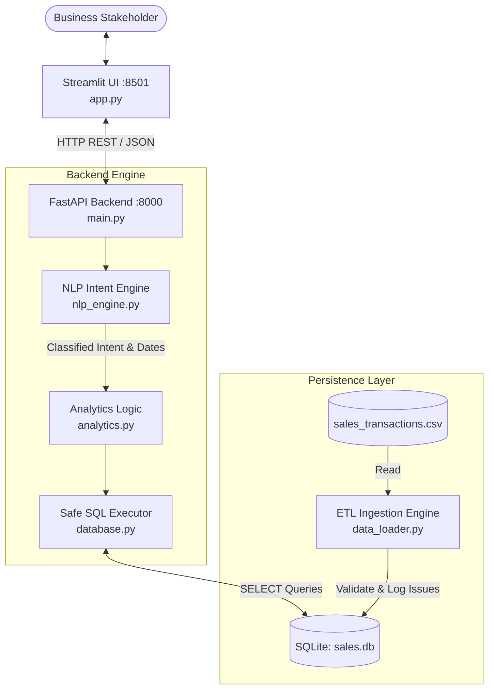

# AI-Assisted Business Intelligence Assistant

[](https://www.python.org/)
[](https://fastapi.tiangolo.com/)
[](https://streamlit.io/)
[](https://www.sqlite.org/)
[](https://pytest.org/)

An enterprise-grade, local-first Business Intelligence (BI) assistant developed for the **Software Development Graduate Engineer Trainee (GET)** technical assessment. The application allows business stakeholders to ask natural language questions regarding sales transaction data and receive instant, verifiable answers backed by deterministic SQLite aggregation queries, interactive KPI cards, trend charts, and data quality logs.

---

## 1. Project Purpose & Highlights

- **Deterministic Business Intelligence**: Zero hallucinations. All business answers are calculated directly from real transaction data in SQLite using clean, audited SQL logic.
- **Robust Data Quality & Auditing**: Detects and logs anomalies (returns, missing unit prices, zero quantities, discounts) in a dedicated audit log without silently corrupting accounting metrics.
- **Safe SQL Execution Layer**: Pre-compiled parameterized queries only. Strictly prohibits destructive keywords (`DROP`, `DELETE`, `UPDATE`, `INSERT`, `ALTER`) or arbitrary user/LLM-generated SQL execution.
- **Modern REST API & Interactive UI**: Decoupled architecture with FastAPI backend (OpenAPI docs at `/docs`) and Streamlit web dashboard.
- **Comprehensive Automated Testing**: 88 unit, integration, validation, and API test cases passing with 100% success.
- **Windows-Ready**: Native PowerShell and batch startup scripts with explicit UTF-8 character encoding support.

---

## 2. Architecture Overview



For comprehensive technical specifications, security threat models, and sequence diagrams, refer to [docs/ARCHITECTURE.md](docs/ARCHITECTURE.md).

---

## 3. Data Quality Findings & Business Rules

Based on rigorous exploratory data analysis of the supplied CSV dataset (`51` records, Jan 2026 – Jun 2026):

| Anomaly Identified | Record Example | Business Accounting Policy | Action Taken |
|---|---|---|---|
| **Returned Goods** | `TXN0033` (Monitor, ₹19,000 gross) | Returned items generate no net revenue | Ingested with `is_valid = 0`; excluded from revenue totals; logged in audit table |
| **Missing Unit Price** | `TXN0051` (Laptop Stand, 5 units) | Price cannot be safely assumed or silently zeroed | Ingested with `unit_price = NULL, is_valid = 0`; excluded from revenue; logged |
| **Zero Quantity** | `TXN0034` (Keyboard, 0 units) | Valid order, zero unit shipment | Ingested with `revenue = 0.0, is_valid = 1`; counts towards volume |
| **Monetary Discounts** | `TXN0004` (₹500), `TXN0022` (₹2,500) | Discounts are flat monetary deductions (₹), not % | Net Revenue = $(\text{Quantity} \times \text{Price}) - \text{Discount}$ |
| **Idempotent Ingestion** | Re-running ingestion pipeline | Repeated ingestion must not create duplicate entries | Enforces `UNIQUE(transaction_id)`; duplicates safely skipped |

Complete audit details and rule rationales are documented in [docs/DATA_QUALITY_REPORT.md](docs/DATA_QUALITY_REPORT.md).

---

## 4. Assessment Requirements Mapping

| # | Requirement | Implementation Component | Verification Test | Status |
|---|---|---|---|---|
| **1** | CSV database loading & error handling | `data_loader.py`, `database.py` | `tests/test_data_loader.py` (18 tests) | Verified |
| **2** | Backend API accepting user questions | `main.py` (`POST /ask`) | `tests/test_api.py` (18 tests) | Verified |
| **3** | Q1: What is the total revenue? | `analytics.py::get_total_revenue` | `test_analytics.py::TestTotalRevenue` | Verified |
| **4** | Q2: Highest revenue product | `analytics.py::get_highest_revenue_product` | `test_analytics.py::TestHighestRevenueProduct` | Verified |
| **5** | Q3: Monthly revenue trend | `analytics.py::get_monthly_revenue_trend` | `test_analytics.py::TestMonthlyRevenueTrend` | Verified |
| **6** | Q4: Highest sales region | `analytics.py::get_highest_sales_region` | `test_analytics.py::TestHighestSalesRegion` | Verified |
| **7** | Q5: Revenue change between months | `analytics.py::get_revenue_comparison` | `test_analytics.py::TestRevenueComparison` | Verified |
| **8** | AI / NLP Interpretation & Guardrails | `nlp_engine.py` (scoring & validation) | `tests/test_nlp_engine.py` (26 tests) | Verified |
| **9** | User Interface with KPIs & Tables | `app.py` (Streamlit dashboard) | End-to-end live testing (`verify_live.py`) | Verified |
| **10** | Automated Tests & Edge Cases | `tests/` directory (88 test cases) | Pytest suite execution | Verified |
| **11** | AI Usage & Debugging Reflection | `docs/AI_DEVELOPMENT_REFLECTION.md` | Deliverable documentation | Verified |

---

## 5. Prerequisites & Environment

- **Operating System**: Windows 10 / 11 (PowerShell or Command Prompt)
- **Python**: Python 3.11 or 3.12 (Tested on Python 3.12.6)
- **Git** (for version control)

---

## 6. Installation & Setup (Windows PowerShell)

Open Windows PowerShell in the project directory (`D:\RSG`):

### Step 1: Create and Activate Virtual Environment
```powershell
# Create isolated virtual environment
python -m venv .venv

# Activate virtual environment
.\.venv\Scripts\Activate.ps1
```

> *Tip: If execution policies restrict scripts, run `Set-ExecutionPolicy -Scope Process -ExecutionPolicy Bypass`.*

### Step 2: Install Required Dependencies
```powershell
pip install -r requirements.txt
```

### Step 3: Ingest Sales Transactions Data
```powershell
$env:PYTHONIOENCODING="utf-8"
python data_loader.py
```
*Output indicates 51 records ingested, 3 data quality issues logged into `sales.db`.*

---

## 7. Launching the Application

### Option A: One-Click Startup Script (Recommended)
You can launch both services simultaneously using either:
```powershell
# In PowerShell:
.\run.ps1
```
or double-click `run.bat` in Windows Explorer.

---

### Option B: Separate Terminal Windows

#### Terminal 1 — Start FastAPI Backend:
```powershell
.\.venv\Scripts\Activate.ps1
$env:PYTHONIOENCODING="utf-8"
uvicorn main:app --host 127.0.0.1 --port 8000 --reload
```
*Backend is running at [http://127.0.0.1:8000](http://127.0.0.1:8000)*  
*Interactive Swagger Documentation: [http://127.0.0.1:8000/docs](http://127.0.0.1:8000/docs)*

#### Terminal 2 — Start Streamlit Frontend:
```powershell
.\.venv\Scripts\Activate.ps1
$env:PYTHONIOENCODING="utf-8"
streamlit run app.py --server.port 8501
```
*Frontend opens automatically in your browser at [http://127.0.0.1:8501](http://127.0.0.1:8501)*

---

## 8. Verified Business Questions & Real Results

All results are dynamically computed from the actual CSV records:

| Business Question | Natural Language Answer | Key Supporting Data |
|---|---|---|
| **What is the total revenue?** | *The total revenue is ₹1,439,200.00* | Gross: ₹1,443,700.00, Discounts: ₹4,500.00, Valid Txns: 49 |
| **Which product generated the highest revenue?** | *'Monitor' generated the highest revenue of ₹473,000.00 from 9 transactions* | 50 units sold (avg ₹9,500/unit) |
| **What is the monthly revenue trend?** | *Monthly revenue trend (upward overall)* | Jan: ₹210.25k, Feb: ₹234.6k, Mar: ₹223.9k, Apr: ₹240.7k, May: ₹318.5k, Jun: ₹211.25k |
| **Which region generated the highest sales?** | *The 'South' region generated the highest sales of ₹411,200.00 from 13 transactions* | 182 units sold |
| **How did revenue change between January and February?** | *Revenue increased from January (₹210,250.00) to February (₹234,600.00). Change: ₹24,350.00 (+11.58%)* | Jan: ₹210,250 vs Feb: ₹234,600 |

Additional supported analytics:
- *Show revenue by category* (Electronics: ₹473k, Furniture: ₹443.5k, Accessories: ₹522.7k)
- *Compare online vs retail sales* (Online: ₹754.7k, Retail: ₹684.5k)
- *Show discount analysis* (4 transactions discounted totaling ₹4,500)
- *What are the top transactions?* (Ranked descending by net transaction revenue)

---

## 9. API Reference & Request Examples

### Health Check
```bash
curl -X GET "http://127.0.0.1:8000/health"
```
**Response**:
```json
{
  "status": "healthy",
  "database": "connected",
  "record_count": 51,
  "version": "1.0.0"
}
```

### Ask Business Question
```bash
curl -X POST "http://127.0.0.1:8000/ask" \
     -H "Content-Type: application/json" \
     -d '{"question": "Which product generated the highest revenue?"}'
```
**Response**:
```json
{
  "question": "Which product generated the highest revenue?",
  "question_type": "highest_revenue_product",
  "question_description": "Highest Revenue Product",
  "confidence": 1.0,
  "answer": "'Monitor' generated the highest revenue of ₹473,000.00 from 9 transactions",
  "error": false,
  "data": {
    "top_product": "Monitor",
    "top_revenue": 473000.0,
    "tied": false,
    "products": [...]
  }
}
```

### Data Quality Summary
```bash
curl -X GET "http://127.0.0.1:8000/data-quality"
```

---

## 10. Automated Testing & Verification

Run the full automated test suite (88 test cases):
```powershell
.\.venv\Scripts\python.exe -m pytest tests/ -v
```

Run live server smoke testing:
```powershell
$env:PYTHONIOENCODING="utf-8"
.\.venv\Scripts\python.exe verify_live.py
```

### Actual Test Results
```
tests/test_analytics.py    .......................... (26 passed)
tests/test_api.py          ..................         (18 passed)
tests/test_data_loader.py  ..................         (18 passed)
tests/test_nlp_engine.py   .......................... (26 passed)
======================== 88 passed in 2.17s ========================
```

---

## 11. Known Limitations & Future Roadmap

- **NLP Vocabulary**: Current intent classifier matches rule-based keywords and temporal phrases. Unsupported sentence structures fallback to friendly guidance.
- **Agentic AI & Vectorless RAG**: Designed to support drop-in integration with LangChain / Google Antigravity SDK agents using table schema vectorless context.
- **Database Scope**: Currently utilizes SQLite in WAL mode; can be seamlessly migrated to PostgreSQL by swapping connection strings in `database.py`.

---

## 12. Project Directory Tree

```
D:\RSG\
├── Input\
│   ├── AI Assisted Development Challenge - GET.docx
│   ├── ai_bi_assistant_sales_data - GET.csv
│   └── Software Development Graduate Engineer Trainee.docx
├── docs\
│   ├── ARCHITECTURE.md
│   ├── DATA_QUALITY_REPORT.md
│   └── AI_DEVELOPMENT_REFLECTION.md
├── tests\
│   ├── __init__.py
│   ├── conftest.py
│   ├── test_analytics.py
│   ├── test_api.py
│   ├── test_data_loader.py
│   └── test_nlp_engine.py
├── .gitignore
├── analytics.py
├── app.py
├── database.py
├── data_loader.py
├── main.py
├── nlp_engine.py
├── README.md
├── requirements.txt
├── run.bat
├── run.ps1
├── sales.db
└── verify_live.py
```
