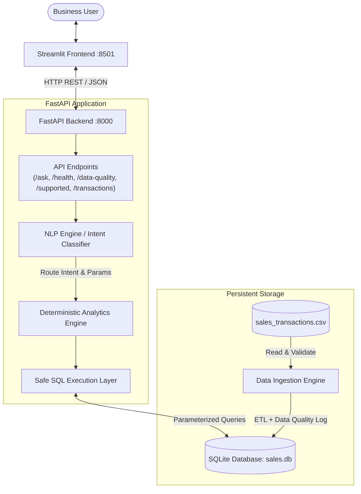
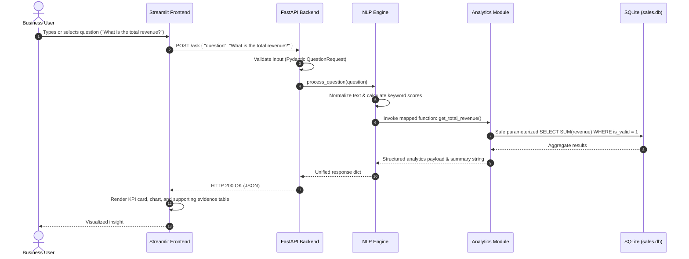
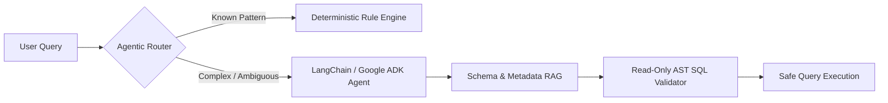

# System Architecture & Technical Design

## 1. Overview

The **AI Business Intelligence Assistant** is a local-first, modular analytical application built to answer natural language business questions about enterprise sales transactions. It is designed to demonstrate strong software engineering fundamentals, defensive coding, data quality rigor, and safe query execution as expected for the Graduate Engineer Trainee (GET) assessment.

---

## 2. Architecture Layers

### Layer Responsibilities

1. **Presentation Layer (`app.py` - Streamlit)**:
   - Interactive web interface running on port 8501.
   - Natural language input bar with clickable preset suggestion chips.
   - Dynamic rendering of KPIs (metric cards), interactive charts (altair/bar/line), and evidence tables.
   - Transparent display of data quality metrics, excluded rows, and rejection explanations.
   - Robust error handling for service interruptions or unsupported queries.

2. **API Layer (`main.py` - FastAPI)**:
   - RESTful API running via Uvicorn on port 8000.
   - Pydantic v2 data models for strict request validation and schema definition.
   - Interactive OpenAPI documentation available at `/docs` and ReDoc at `/redoc`.
   - Health monitoring endpoint (`GET /health`) reporting DB connectivity and record counts.
   - Question processing endpoint (`POST /ask`) returning structured JSON payloads.

3. **Natural Language Processing Layer (`nlp_engine.py`)**:
   - Deterministic rule-based intent classification and entity extraction.
   - Multi-keyword pattern scoring with negative weighting to prevent misclassification.
   - Temporal parameter extraction (e.g. mapping "Jan" / "January" to month codes `01`).
   - Clear classification confidence scoring and fallback for unsupported questions.
   - Modular interface allowing seamless replacement with an LLM agent (e.g. LangChain, LlamaIndex, Google ADK).

4. **Analytics & Business Logic Layer (`analytics.py`)**:
   - Pure, deterministic calculation functions for all business questions:
     - Q1: Total Revenue (Gross, Net, Total Discounts)
     - Q2: Highest Revenue Product (ranking + tie detection)
     - Q3: Monthly Revenue Trend (chronological sort + Month-over-Month changes)
     - Q4: Highest Sales Region (revenue, unit volume, transaction frequency)
     - Q5: Month-to-Month Revenue Comparison (percentage change, delta, directional indicators)
     - Extended analytics: Category breakdown, Sales channel comparison, Discount analysis.

5. **Data Ingestion & Quality Layer (`data_loader.py` & `database.py`)**:
   - SQLite relational database with strict schema definitions.
   - Idempotent data ingestion with transaction idempotency checks (skips duplicates).
   - Defensive SQL safety: AST/keyword inspection rejecting any `INSERT`, `UPDATE`, `DELETE`, `DROP`, `ALTER`, `EXEC` operations in query execution.
   - Dedicated `data_quality_log` recording every anomaly detected during ETL.

---

## 3. Data Flow Diagram

---

## 4. Security & Safety Model

- **Zero Arbitrary SQL Execution**: The application strictly prohibits raw, unvalidated SQL from users or external language models.
- **SQL Sanitization**: All database interaction passes through `execute_safe_query()` which enforces `SELECT`-only execution, validates statement beginnings, and checks keyword boundaries.
- **Parameterized Queries**: All user-derived parameters (such as month names or product filters) are passed exclusively via SQL placeholders (`?`), neutralizing SQL injection vectors.
- **Local Isolation**: Fully self-contained on the host machine without external network requirements, remote database connections, or API key dependencies.

---

## 5. Agentic AI & Future LLM Roadmap

The assignment syllabus emphasizes Agentic AI, Generative AI, RAG, and Vectorless RAG. The architecture is explicitly decoupled to accommodate advanced AI capabilities:

- **Vectorless RAG**: Providing table schema, column definitions, and business rule prompt templates directly into the LLM context window without requiring heavy vector databases.
- **Agentic Multi-Step Reasoning**: Allowing an LLM agent to decompose complex questions (e.g. "Which product had the greatest drop in sales between February and March?") into multiple analytical queries.
- **AST SQL Guardrails**: Using `sqlglot` or `sqlparse` to validate LLM-generated SQL against an allowlist of read-only abstract syntax tree expressions before dispatching to SQLite.
